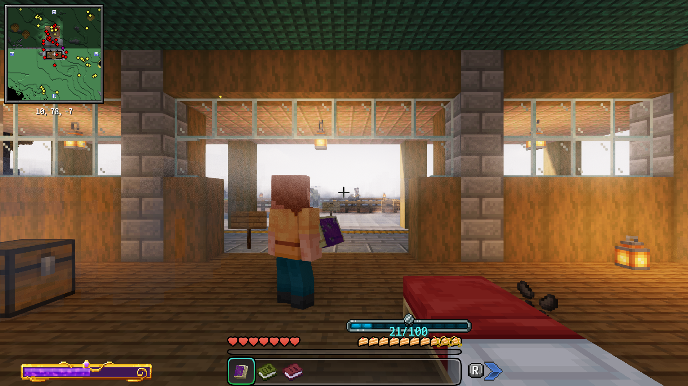

# 神格之路 GodPath · 高山远征

从枢纽站领一把练习刀，乘矿车穿过山谷，到松脊前哨开始远征。沿途收集原初、丰饶、机械、连接、奥秘与斩断六种法则的神物，决定自己先造一座庄园、深入遗迹，还是练刀打首领。集齐二十四件神物后可完成成神仪式，解锁飞行与神格武装。

- **两种开局**：高山远征地图提供双站铁路、训练场和引导；普通新建世界也能用 `/journey` 查看六法则路线。
- **拔刀与神格**：拔刀剑左键能空挥和命中连击，保留原模组右键。`F8` 使用神格刀技；轨道炮用 `F7` 切换模式，长按右键蓄力。
- **画面与探索**：CozyUI、简体中文、MakeUp Ultra Fast、可选远景和六道遗迹。机器吃紧可先降低光影预设和远景距离；区块可分批预热。

Minecraft **1.21.1** · NeoForge **21.1.250** · Java **21**。PCL2 或兼容 Modrinth 包的启动器可导入 `.mrpack`；另附独立地图压缩包。地图解压进该实例的 `saves/`，首次进入会准备车站和沿线区块。详细步骤见[安装与游玩](pack/README.md)。

[下载与版本说明](../../releases) · [实测记录](docs/4.1.0-高山远征与实测.md) · [第三方内容](THIRD_PARTY_NOTICES.md)

`pack/` 是整合包配置、资源和原创 KubeJS 玩法；`scripts/final_mods.json` 锁定依赖与校验值。运行 `npm ci`、`npm test` 和 `python -X utf8 scripts/gen_release.py` 可检查和构建，详见[贡献指南](CONTRIBUTING.md)。
